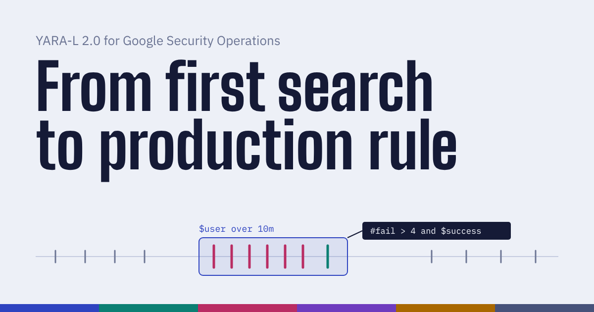

# YARA-L field manual

**From first search to production rule.** A free, interactive field manual for security analysts and detection engineers learning YARA-L 2.0 in Google Security Operations. Read it front to back, or keep it open as a reference while you work.

## What's inside

- **Thirteen modules in five tracks:** foundations, UDM Search, detection rules, advanced features, and running rules in production.
- **Diagrams** for the ideas that are easiest to get wrong: windows, joins, counting, absence, repeated fields.
- **Interactive pieces:** a window explorer, rule anatomy views, a risk score builder and a clickable UDM model.
- **Practice:** eleven tasks with hidden answers.
- **Alert-triage cookbook:** 42 searches and rules across endpoint, identity, network, cloud, email and Linux.
- **Quick reference:** a rule skeleton, operation chart, limits table and glossary, printable as a cheat sheet.

The whole site is a single `index.html` with no build step and no dependencies apart from Google Fonts.

## Keep in mind

Google Security Operations changes with every release. Resource limits, UI details and some behaviours described here can drift. The queries and rules are written from Google's documentation and have not been run against every tenant, and field placement varies by parser. Check anything you build on against the [current documentation](https://docs.cloud.google.com/chronicle/docs/yara-l/yara-l-overview) and test it in your own environment.

## Found a mistake?

Open an issue in this repository. Corrections to limits, field names and rule logic are especially welcome.

## Licence

Content is licensed under [CC BY 4.0](https://creativecommons.org/licenses/by/4.0/). See [LICENSE](LICENSE).

This is an independent learning resource. It is not affiliated with or endorsed by Google. Google and Google Security Operations are trademarks of Google LLC.
